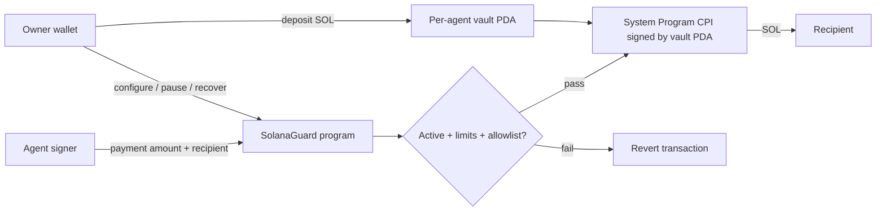

# SolanaGuard

**Owner-controlled SOL budgets for autonomous agents on Solana.**

An agent should be able to pay for work without receiving unrestricted control over its owner's funds. SolanaGuard gives each owner/agent pair a vault PDA: the owner deposits SOL, sets spending limits, and can pause the agent or recover the vault balance. The agent requests a payment; the program checks the policy and executes the actual System Program transfer in the same transaction.

**v0.2 audit candidate · locally tested · unaudited · native SOL only.** This branch has not been deployed. The existing [web demo](https://solanaguard.app) is an off-chain policy evaluation interface; it does not send vault payments. The upstream repository reports an earlier devnet deployment. Neither is evidence that this branch is deployed.

## Run the reviewer demo

With Rust and `cargo-build-sbf` installed:

```bash
cargo build-sbf --manifest-path programs/solana_guard/Cargo.toml -- --locked
cargo test --locked --test policy_flow judge_demo -- --nocapture
```

The demo loads the compiled Solana bytecode into LiteSVM, funds an isolated vault, pays 0.5 SOL, rejects an over-limit payment, pauses spending, and recovers the remaining balance. It uses simulated lamports, no network, wallet credentials, or real funds. Assertions check balances and state, rather than just an approval message.

## What is enforced

| Control | Behavior |
| --- | --- |
| Per-payment limit | Rejects amounts above the owner-defined lamport limit |
| Spending window | Caps cumulative successful payments in a 24-hour window |
| Agent pause | Owner can disable and re-enable delegated spending |
| Policy pause | An inactive policy blocks delegated spending |
| Program allowlist | System Program must be allowed; empty list blocks all payments |
| Vault custody | Only this program can sign for the per-agent vault PDA |
| Recovery | Owner can withdraw to their own address even while paused |
| Receipt | Successful payment records owner, agent, recipient, amount, time, and nonce |
| Atomicity | Failed transactions do not transfer funds, consume budget/nonce, or persist receipts |

The spending window begins at policy creation, then restarts on the first successful payment at least 86,400 seconds after its start. It is **not** a trailing-24-hour sum. Policy edits preserve counters. Agent payments preserve the vault's zero-data rent reserve; the owner can recover the full balance.



## Trust and scope

Protection applies to SOL deposited in the vault. An agent's ordinary wallet, transaction fees, receipt rent, off-chain decisions, SPL tokens, arbitrary DeFi calls, and funds outside the vault are outside this policy boundary. Recipients are unrestricted System-owned accounts: spending limits do not guarantee that a recipient is trustworthy. The program accepts no arbitrary CPI payloads or remaining-account forwarding.

The owner can change limits and recover funds. Deployment upgrade authority can change program code; this must be disclosed and secured before production. The dashboard's wallet proof and database pause are separate from the on-chain agent signer and pause. A dashboard verdict does not authorize or prove a vault transfer. Successful receipts persist; rejected events are execution logs, not durable program accounts.

See [audit scope and invariants](docs/AUDIT-SCOPE.md), [deployment notes](docs/DEPLOYMENT.md), and [verification evidence](docs/VERIFICATION.md). Passing tests is not an external security audit.

## Instructions and accounts

| Instruction | Signer | Effect |
| --- | --- | --- |
| `register_agent` | Owner | Create config and monotonic nonce |
| `set_policy` | Owner | Create one policy; positive per-tx cap, daily cap ≥ per-tx cap, ≤10 programs |
| `update_policy` | Owner | Patch fields without resetting spend history |
| `toggle_agent`, `pause_agent`, `unpause_agent` | Owner | Change delegated spending state |
| `deposit_sol` | Owner | Transfer owner SOL into this agent's vault |
| `withdraw_sol` | Owner | Transfer vault SOL back to owner |
| `validate_and_execute` | Agent | Check policy and atomically transfer SOL, consume budget/nonce, write receipt |

All amounts are integer **lamports**. One SOL = 1,000,000,000 lamports.

| PDA | Seeds |
| --- | --- |
| Agent config | `agent_config`, owner, agent |
| Policy | `policy`, config |
| Nonce | `agent_nonce`, owner, agent |
| Vault | `vault`, config |
| Payment receipt | `tx_log`, config, nonce as little-endian u64 |

The vault is a System-owned, zero-data account at a PDA derived by SolanaGuard. The program controls its signing authority; it is not a data account owned by SolanaGuard.

## SDK

```bash
npm --prefix sdk ci --ignore-scripts
npm --prefix sdk test
```

The [TypeScript SDK](sdk/README.md) builds instructions for owner setup, funding, pause/recovery, and agent payments. It uses `bigint`, explicit account derivation, and the generated IDL. Golden fixtures generated by Rust verify binary argument encoding, account order, signer flags, and PDA addresses. It does not request private keys or submit transactions automatically.

## Verify the candidate

```bash
# Rustup-managed Cargo must precede Homebrew Cargo on this host.
export PATH="$HOME/.cargo/bin:$PATH"
./scripts/verify.sh
```

The script builds SBF, runs Rust and SDK tests, regenerates/checks IDL and Rust ABI fixtures, builds the existing web app, and validates the scope manifest. Install Node 22+, Python 3, Rust, `cargo-build-sbf`, and Anchor CLI first; tested versions are recorded in [verification evidence](docs/VERIFICATION.md). Run from a committed checkout to check generated-file drift.

```bash
python3 scripts/audit-scope.py          # regenerate counts and hashes after changes
python3 scripts/audit-scope.py --check  # detect a stale scope
```

## Existing web demo

```bash
npm --prefix app ci --ignore-scripts
npm --prefix app run dev
```

The app uses the existing InsForge backend when configured. No backend or hosted deployment was changed for this branch. See `AGENTS.md`, `functions/`, and `migrations/` for the separate off-chain implementation. The root `src/` is an earlier landing-page prototype; the deployable app lives in `app/`.

## Audit grant preparation

The [Vaultline readiness checklist](docs/grants/vaultline-readiness.md) maps the candidate to the listing. Colosseum participation must be supported by the actual submission link. No grant application has been submitted and no selection is promised. Publish the reviewed branch, confirm project/team facts, and freeze the audit commit before applying.

Repository base: [`abhigyan1102/solana`](https://github.com/abhigyan1102/solana), commit `dd40957`. The older [`solana-guard`](https://github.com/abhigyan1102/solana-guard) was inspected for comparison; its SDK uses a different program ID and inconsistent seed derivations and was not copied. This candidate uses the newer program's account model throughout.

## License

Proprietary; copyright Abhigyan Singh. See [LICENSE](LICENSE). Public repository access does not grant reuse rights. Obtain the owner's permission before modifying, distributing, or submitting this code. No license change is made by this audit-readiness branch.
